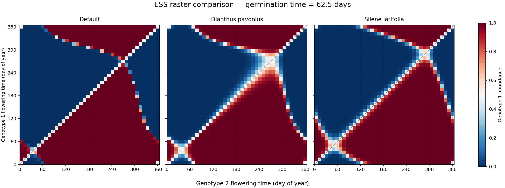

# When should a pathogen strike? Navigating the landscape of birth pulses and mating season

Code for the manuscript by Bhargav D. Srinivasan, Emily L. Bruns and Samuel V. Hulse
(Department of Biology, University of Maryland, College Park).

A seasonally forced, age-structured model of *Silene latifolia* and its anther-smut
pathogen *Microbotryum* is used to ask how the timing of seed germination and host
flowering shapes equilibrium disease prevalence and the evolutionarily stable timing of
infectious flowering, found by invasion analysis (Floquet exponents of a rare mutant).

## Contents

| Path | Purpose |
|---|---|
| `src/parameters.py` | Parameter sets for *S. latifolia* (Table 1) and *D. pavonius* |
| `src/timing.py` | Seasonal forcing (Equations 1–3) |
| `src/model.py` | The model (Equations 4–10) and the prevalence statistic |
| `src/plot.py` | Equilibrium-prevalence sweeps and Figures 2–3 |
| `src/floquet.py` | Invasion fitness, singular strategies, ESS classification, and the plots of Figures 4–6 |
| `test/figs.py` | Reproduces Figures 2–6 |
| `test/confirm_dimorphism.py` | Two-genotype simulations confirming each predicted polymorphism |
| `test/realized_germination.py` | Realized germination timing and the ESS offset from median germination |
| `test/supp_figs.py` | Supplementary Figures S1–S3 |

## Reproducing the results

```bash
pip install -r requirements.txt
cd test
python figs.py --fig sweeps          # all simulations (see run times below)
python figs.py                       # Figures 2–6 from the saved sweeps
python confirm_dimorphism.py         # confirms the polymorphisms reported in the Results
python realized_germination.py       # median germination day and ESS offset (Results)
python supp_figs.py                  # Figures S1–S3
```

All output is written to `figs/`, which is not tracked. Sweeps are cached there as `.npz`
files; delete a file to recompute it. Everything runs on an ordinary desktop or laptop with
Python ≥ 3.10, NumPy, SciPy and Matplotlib (`requirements.txt`); the simulations use every
available core, so the three invasion-fitness sweeps take a few hours in total on a typical
machine (about an hour each on 32 cores).



*Two pathogen genotypes with different infectious flowering times competing in the full model, for three
parameter sets, as the germination midpoint moves through the year. Colour gives the share of infections
carried by genotype 1; the crossing point is the flowering time that cannot be displaced.*
