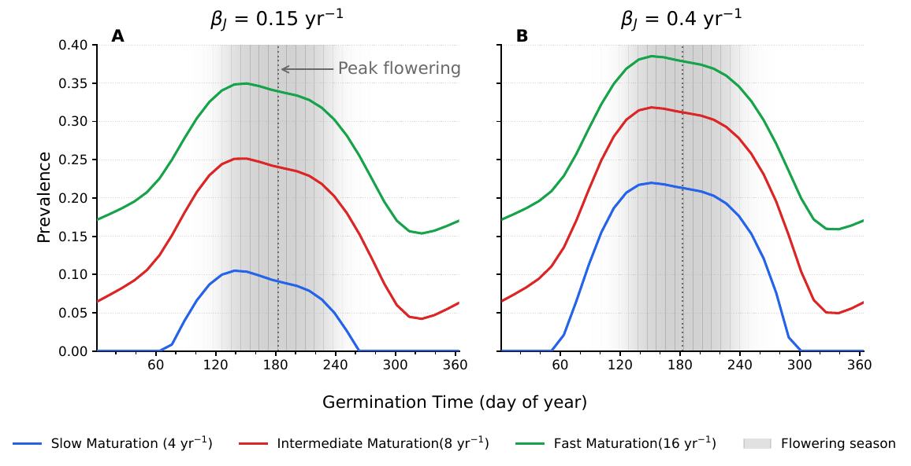
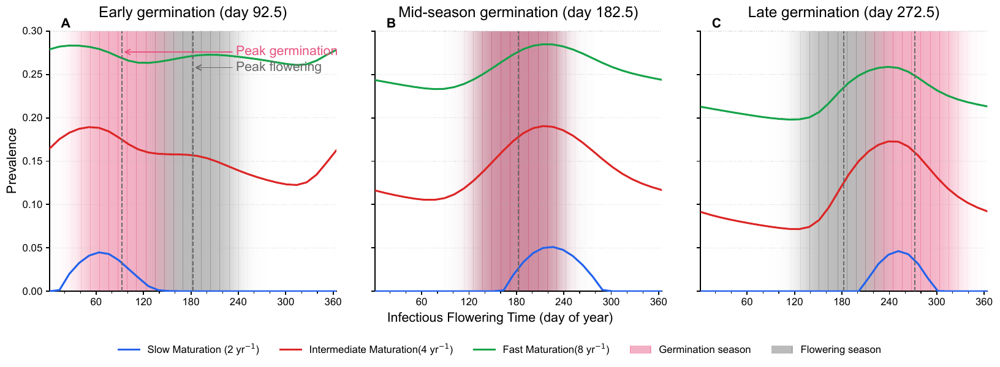
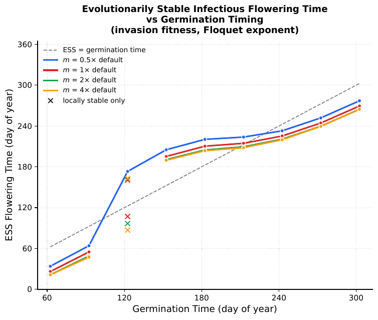
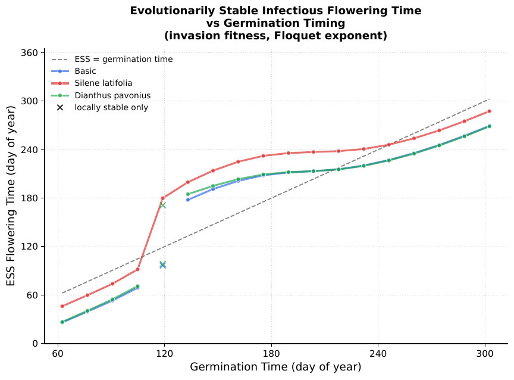
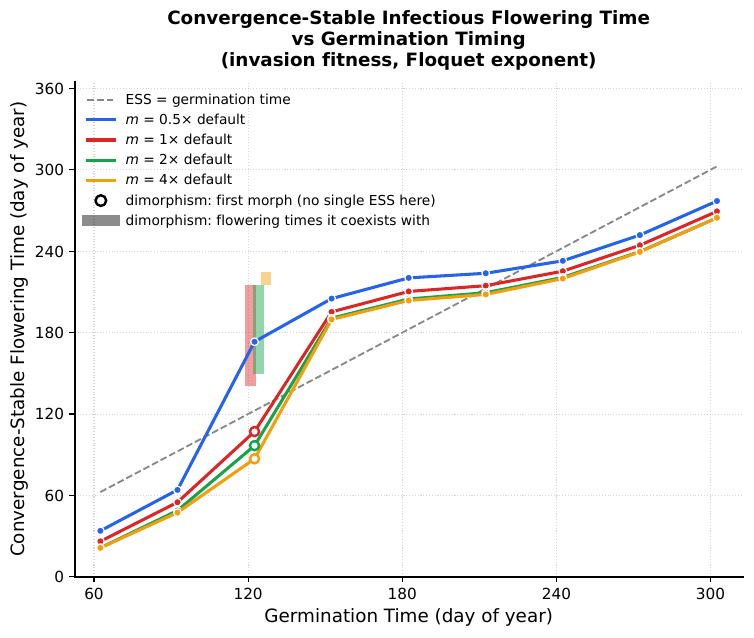
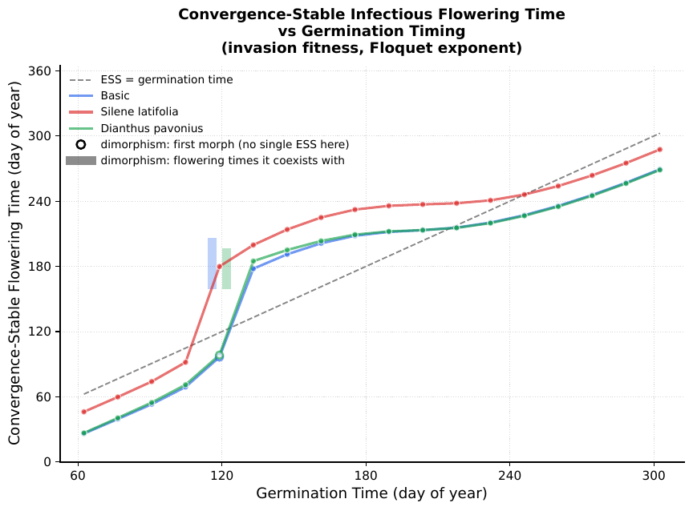
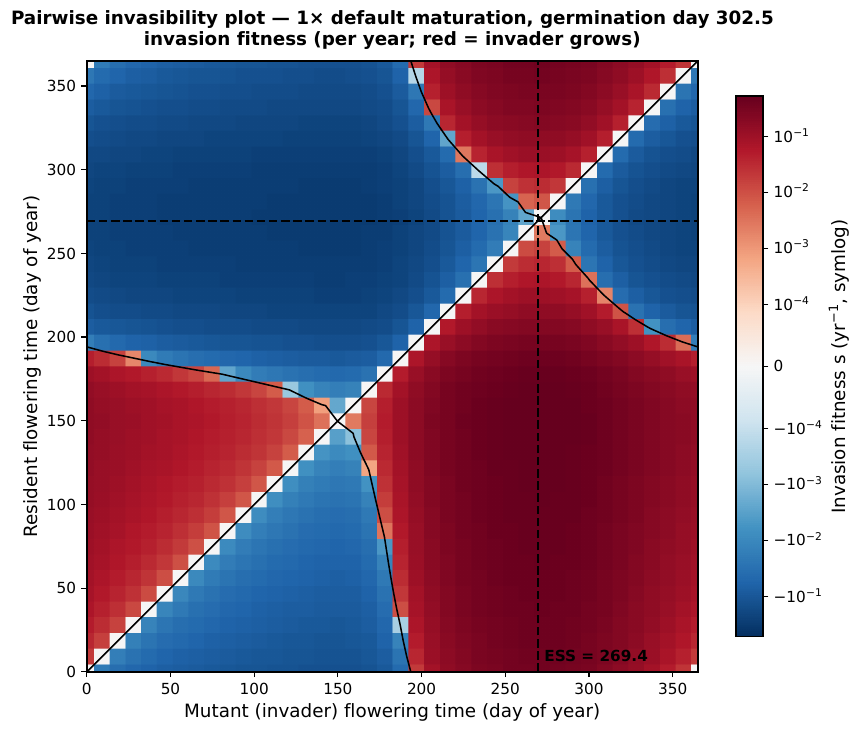
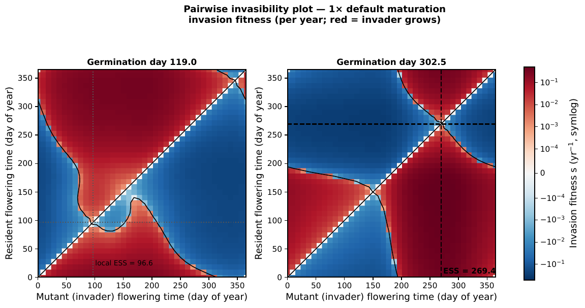
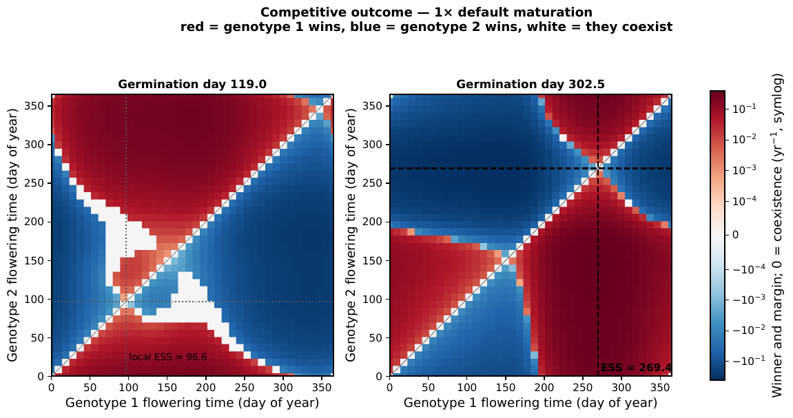

# Host–Pathogen Evolutionary Dynamics Model

A seasonally forced host–pathogen model for *Silene latifolia* and anther smut
(*Microbotryum*), used to ask when a pathogen's **infectious flowering time** is
evolutionarily stable and how that answer depends on the host's **germination timing**.

The pathogen transmits only from infected *flowering* plants, so an infection has to run
`susceptible juvenile → infected juvenile → infected vegetative → infected flowering`
and arrive while susceptible hosts are available. Both the host's germination pulse and
the pathogen's flowering schedule are seasonal, which makes flowering time a genuine
evolutionary trait with frequency-dependent selection.

**Main results.** For most germination timings there is a single evolutionarily stable
flowering time, tracking germination with a lag. In a narrow germination window
(~day 119) that breaks down: two flowering times ~60–110 days apart each invade the
other and coexist indefinitely — a protected dimorphism, confirmed by direct simulation
of the full nonlinear model.

---

## The model

Ten state variables: susceptible seeds/juveniles/vegetative/flowering
(`Sd, Sj, Sv, Sf`), and the infected classes of two competing pathogen genotypes
(`Ij, Iv, If` and `Ij2, Iv2, If2`). For a single genotype:

$$\begin{align*}
\dot{S_j} &= b(t)S_f - S_j(\beta_j I_f + \gamma N + m + \mu)\\
\dot{S_v} &= m S_j + v(t)_s S_f - S_v(\beta_v  I_f + f(t)_s + \mu)\\
\dot{S_f} &= f(t)_s S_v - S_f(\beta_f I_f + v(t)_s + \mu)\\
\dot{I_j} &= \beta_j S_j I_f - I_j(m + \mu)\\
\dot{I_v} &= m I_j + \beta_v S_v I_f  + v(t)_I I_f - I_v(f(t)_I + \mu)\\
\dot{I_f} &= f(t)_I I_v + I_f(\beta_f S_f - v(t)_I - \mu)
\end{align*}$$


**Seasonality** (`src/timing.py`). Temperature is a cosine with a 365-day period; the
germination, flowering and vegetating rates are logistic functions of it. A genotype's
*phase* is set by shifting that temperature curve: `germination_time`,
`susceptible_time`, `infected_time` (genotype 1) and `infected_time2` (genotype 2) are
days of the year. The pathogen's `infected_time` is the evolving trait throughout.

**Default parameters** (`src/model.py`; all rates per day):

| parameter | default | meaning |
|---|---|---|
| `Bj` | 0.2/365 | transmission to juveniles |
| `Bv`, `Bf` | 0.025/365 | transmission to vegetative / flowering adults |
| `births` | 4/365 | seed production by healthy flowering plants |
| `gamma` | 1e-4 | density-dependent competition |
| `death` | 0.5/365 | background mortality |
| `maturity` | 8/365 | juvenile → vegetative maturation |
| `g` | 2/365 | seed → juvenile germination |

Two published parameterizations are also included: *Silene latifolia*
(Slowinski et al. 2025) and *Dianthus pavonius* (Bruns et al. 2017), both in
`test/figs.py` under `FIG4_CONFIGS`.

---

## Results

### Where the ESS sits, across germination times


Competition rasters at nine germination times for three parameter sets. Each frame is a
40×40 grid of genotype-1 vs genotype-2 flowering times; the ESS shifts as the
germination pulse moves through the year. Built by `test/plot_ess_rasters.py`.

### Prevalence depends on germination timing



Equilibrium prevalence (infected fraction of the population) against germination day,
for three maturation rates and two juvenile transmission rates. Prevalence peaks when
germination precedes flowering by roughly 60 days. Note that the **slow-maturation**
curves hit zero: at 4 yr⁻¹ the infection chain is too slow to close within a year when
flowering is badly timed, and the pathogen goes extinct (R₀ < 1). At the default
8 yr⁻¹ and above, it persists at every germination time.

The companion sweep over the pathogen's own flowering time, for the *Dianthus*
parameterization:



### Evolutionarily stable flowering time

| maturation sweep | species parameterizations |
|---|---|
|  |  |

ESS flowering time against germination time, from invasion fitness. Multipliers are
relative to the model default of 8 yr⁻¹. The ESS tracks germination with a lag, and
jumps between an early-flowering and a late-flowering branch near germination day 120.
Gaps and crosses are germination times with **no globally uninvadable strategy**.

The same sweeps drawn along the convergence-stable branch, so the curve is unbroken,
with the dimorphisms marked — open circle is the convergence-stable morph, bar is the
set of flowering times that coexist with it:

| maturation sweep | species parameterizations |
|---|---|
|  |  |

### Pairwise invasibility



Invasion fitness of a rare mutant (x-axis) against an established resident (y-axis), at
germination day 302.5. Red means the mutant grows. The zero contour crosses the diagonal
at the singular strategies; the ESS at day 269.4 is the resident whose entire row is
blue — nothing invades it. Reading a PIP: the diagonal is always neutral, and away from
coexistence a red cell has a blue mirror image.

### The polymorphism



The same raster at germination day 119 (left) beside day 302.5 as a control (right). At
119 some pairs are red in *both* directions — each genotype invades the other — so no
single flowering time is uninvadable.



The same data recoloured by outcome: red where genotype 1 wins, blue where genotype 2
wins, white where they coexist. This version is antisymmetric by construction, so it
mirrors cleanly across the diagonal and the coexisting pairs stand out as the white
patches off the diagonal. (The thin white band *along* the diagonal is just the
near-neutral zone where the two flowering times are nearly identical.)

**Confirmation.** Mutual invasibility is a linearized, rare-invader criterion, so each
flagged case is re-run in the full nonlinear two-genotype model from both directions —
`test/confirm_dimorphism.py`, results in `figs/dimorphism_checks.txt`:

| parameters | germination | morphs | from morph | from partner |
|---|---|---|---|---|
| 1× default | 122.5 | 107.1 / 196.5 | 0.5774 | 0.5774 |
| 2× | 122.5 | 96.7 / 205.9 | 0.5434 | 0.5434 |
| 4× | 122.5 | 87.0 / 224.6 | 0.3814 | 0.3814 |
| Basic | 119.0 | 96.6 / 187.2 | 0.4299 | 0.4299 |

Both morphs persist, and the equilibrium is the same whichever one starts common, so the
coexistence is protected rather than a founder effect.

**Caveats.** This is ecological coexistence, not evolutionary branching: fitness
curvature is negative at every singular point, so gradual small-step evolution does not
split the population on its own — the dimorphism needs standing variation or an
immigrant 60–110 days away. Convergence takes thousands of model years, and the resting
point of the pair itself would need a two-morph coalition analysis, which is not
included here.

---

## Methods: invasion fitness

While genotype 2 is rare, its infected classes obey a **linear** system whose
coefficients depend only on the resident's annual cycle:

$$\frac{d}{dt}\begin{bmatrix}I_{j2}\\\ I_{v2}\\\ I_{f2}\end{bmatrix} = A(t)\begin{bmatrix}I_{j2}\\\ I_{v2}\\\ I_{f2}\end{bmatrix}, \qquad A(t+365)=A(t)$$

`src/floquet.py` integrates the fundamental matrix over one year to get the monodromy
matrix; the log of its dominant eigenvalue is the invasion fitness s(resident, mutant)
in units of per year. This is exact in the long-run sense — no finite-horizon proxy —
and self-invasion returns ~2e-11, as it should.

**Why not just simulate?** An earlier version scored each pair by genotype share after a
400-year two-genotype run. Near a singular strategy, invasion fitness differences are
~1e-3/yr, so a rare invader needs thousands of years to become visible. At 400 years
every reciprocal pair reads as "whoever starts common wins," which looks like founder
control but is an artifact of the horizon. Floquet exponents removed it: priority
effects are 0.0% of pairs, while genuine coexistence survives. The superseded figures
(3.2, 3.3, 4.2, 4.3, 4_invasion, 5) are still generated by `test/figs.py` for
comparison, but are not tracked here.

---

## Repository layout

```
src/
  model.py              Model class: the ODE right-hand side, parameters, eval metrics
  timing.py             seasonal forcing (temperature, germination/flowering curves)
  plot.py               RasterModel: sweeps, heatmaps, the fig1-fig5 plotting routines
  floquet.py            invasion fitness, ESS/branching classification, PIP rasters
  model_functions.py    older standalone helpers
test/
  figs.py               one function per figure; the entry point for everything
  confirm_dimorphism.py simulates the flagged dimorphisms to confirm they are real
  plot_ess_rasters.py   the raster frames and the animation
  *.ipynb               exploratory notebooks
scripts/
  run_figure.sbatch     generic SLURM job (no site-specific paths)
  submit.sh             wrapper applying SB_* environment overrides
figs/                   published figures, their .npz embeddings, summary.txt
docs/figures/           PNG/GIF copies used by this README
old_nbs/                earlier notebook versions, kept for reference
```

## Running it

```bash
pip install -r requirements.txt

cd test
python figs.py --list               # available figure keys
python figs.py --fig 1              # prevalence vs germination
python figs.py --fig 3_5 4_5 6 7    # redraw from cached embeddings (seconds)
python figs.py --fig 3_4            # full Floquet sweep (~1 h on 32 cores)
```

Figures that depend on a Floquet sweep reuse `figs/*_embedding.npz` when it exists, so
re-running only redraws the plot. Delete the embedding to force a recompute.

Confirming the dimorphisms (hours — the integrations are long by necessity):

```bash
cd test
python confirm_dimorphism.py                      # every flagged case
python confirm_dimorphism.py --config Basic --germination 119
python confirm_dimorphism.py --years 1600 --out ../figs/dimorphism_checks.txt
```

On a cluster:

```bash
SB_ACCOUNT=myacct SB_PARTITION=general SB_QOS=long ./scripts/submit.sh 3_4 4_4
```

Every script derives paths from its own location, so the repo can be cloned anywhere.

## Figure index

| file | what it shows | key |
|---|---|---|
| `fig1.6.pdf` | prevalence vs germination time, 3 maturation × 2 β_J | `1` |
| `fig2.6.*.pdf` | prevalence vs infectious flowering time | `2` |
| `fig3.4.pdf` | ESS vs germination, maturation sweep | `3_4` |
| `fig3.5.pdf` | same, along the convergence-stable branch, dimorphisms marked | `3_5` |
| `fig4.4.pdf` | ESS vs germination, three parameterizations | `4_4` |
| `fig4.5.pdf` | same, convergence-stable branch | `4_5` |
| `fig5.2.pdf` | pairwise invasibility plot, germination 302.5 | `5_2` |
| `fig6.pdf` | pairwise invasibility, germination 119 vs 302.5 | `6` |
| `fig7.pdf` | competitive outcome, coexistence in white | `7` |
| `all_parameters_rasters.gif` | competition rasters across germination times | `plot_ess_rasters.py` |
| `summary.txt` | peak-day statistics per figure | written by each run |
| `dimorphism_checks.txt` | simulation confirmation of the dimorphisms | `confirm_dimorphism.py` |

Earlier versions of figures 3, 4 and 5 (`fig3.2`, `fig3.3`, `fig4.2`, `fig4.3`,
`fig4_invasion`, `fig5`) used the share-after-400-years metric described above. They
regenerate from `figs.py` but are deliberately not tracked.

## References

- Bruns, E.L. et al. (2017) — *Dianthus pavonius* / anther smut parameters.
- Slowinski, S. et al. (2025) — *Silene latifolia* parameters.
- Geritz, S.A.H. et al. (1998) *Evolutionarily singular strategies and the adaptive
  growth and branching of the evolutionary tree.* Evolutionary Ecology 12:35–57 —
  pairwise invasibility plots, mutual invasibility, protected dimorphism.
